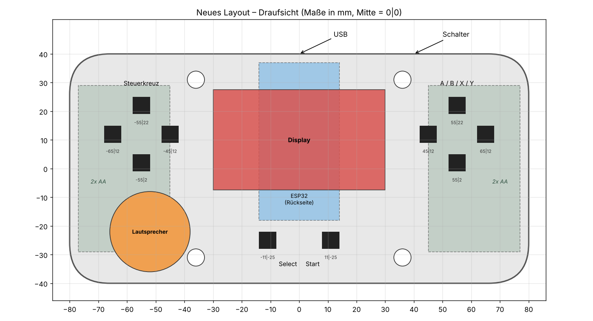
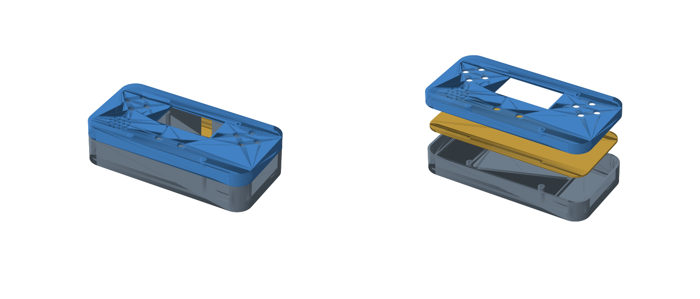

# ESP32-Handheld – neues Layout

Drehbare 3D-Ansicht mit allen Bauteilen: `vorschau_3d.html` im Browser öffnen.

## Was ist neu?

- **Display in der Mitte.** Vorher lag der ESP32 halb auf dem Display. Jetzt sitzt der ESP32 kopfüber
  auf der **Rückseite** der Platine unter dem Display, mit dem USB-Anschluss zur Rückseite. So bleibt er zum Programmieren erreichbar.
- **Steuerkreuz links, A/B/X/Y rechts.** Die Tasten sind jeweils 10 mm auseinander und liegen auf
  gleicher Höhe, damit man sie gut mit den Daumen erreicht.
- **Select/Start** sitzen mittig unter dem Display.
- **Lautsprecher** auf der **Vorderseite** unten links, mit Lochgitter im Deckel.
- **Batterien (4x AA)** liegen in den beiden Griffen unter der Platine. Rippen im Boden halten zwei
  2xAA-Halter fest.
- **Gehäuse** aus Ober- und Unterschale, verschraubt mit 4x M2.5. Eine Öffnung für einen Ein/Aus-Schiebeschalter ist schon drin.

## Dateien (`stl/`)

| Datei | Maße | in Tinkercad auf Höhe (Z) |
|---|---|---|
| `gehaeuse_unten.stl` | 160 x 80 x 20 mm | 0 |
| `platine.stl` | 155 x 75 x 1.6 mm | 19 |
| `gehaeuse_oben.stl` | 160 x 80 x 10 mm | 20 |

## In Tinkercad importieren

1. Oben rechts auf **Importieren** klicken und die drei STL-Dateien nacheinander laden.
2. Alle drei auswählen, dann **Ausrichten** (Taste `L`) wählen und auf die Mitte von X und Y klicken.
3. Die Höhe jedes Teils wie in der Tabelle oben einstellen.
4. Deine Bauteile (ESP32, Display, Taster, Lautsprecher) auf die Positionen aus `layout.png` setzen.
   Die Zahlen bei den Tastern sind X|Y in mm, gemessen von der Gehäusemitte.
5. Zum Reinschauen den Deckel ausblenden oder durchsichtig machen.

## Annahmen (bitte prüfen!)

Die Maße habe ich aus deinem Bild geschätzt. Wenn deine Teile anders groß sind, die Werte oben in
`generate.py` anpassen und `python3 generate.py` erneut ausführen:

- Display-Platine 60 x 35 mm, sichtbares Fenster 54 x 30 mm
- ESP32 DevKit 28 x 55 mm
- Taster 6 x 6 mm, **12 mm hoch** (damit sie durch den 2 mm dicken Deckel ragen)
- Lautsprecher Ø 28 mm
- 2xAA-Batteriehalter 32 x 58 mm

Hinweis: 4x AA ergeben etwa 6 V. Das geht am **VIN**-Pin des ESP32, aber **nicht** am 3.3-V-Pin!
